# SWS405 Digital Forensics - Assignment 2
## MemLabs Memory Forensics Challenge: Labs 1–5

## 1. Introduction

This report documents the investigation of five Windows memory images from the MemLabs memory-forensics challenges. The objective was to use Volatility 2 and supporting tools to identify relevant processes and artifacts, recover hidden flags, and explain how the evidence supports each finding.

The report includes the investigation steps and screenshots supplied in the investigation notes. Each screenshot is intended to support the command or result discussed immediately before it. The investigation focuses on evidence recovery and interpretation rather than simply listing the flags.

## 2. Objectives

- Identify the Windows memory profile for each lab image.
- Examine processes, command history, environment variables, files, and browser artifacts.
- Recover evidence from archives, process memory, password databases, images, and NTFS MFT records where relevant.
- Document the commands and investigative steps, including unsuccessful leads.
- Explain the forensic value and limitations of the techniques used.

## 3. Tools and Environment

The investigation notes document the use of Kali Linux, Volatility 2, Python 2 where required by the installation method, and supporting utilities including GIMP, steghide, unrar, Git, and SQLite tools. The community Volatility plugin pack was used where the built-in plugins did not provide the required browser-history functionality.

## How the Investigation Was Carried Out

For each memory image, I first identified the Windows profile, then examined processes and their relationships. I followed the clues from the challenge instead of relying on a single command. Depending on the lab, I checked command history, environment variables, file objects, password-manager data, browser history, process memory, or NTFS records. When an artifact was recovered, I inspected or decoded it with the appropriate supporting tool and captured the output as evidence. The screenshots are placed next to the steps they support.

## Part A — Installation and Setup
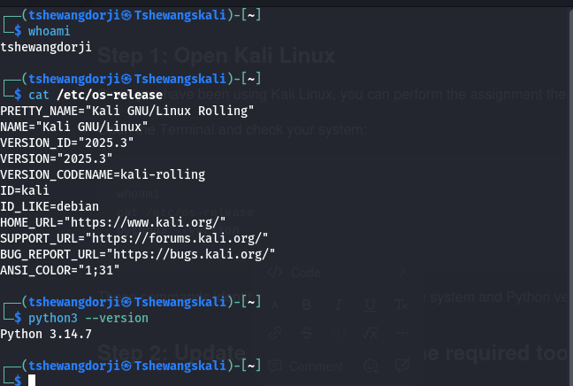

### Updated Kali and installed the required tools

I updated the Kali package list and installed the utilities required for the investigation. These tools provided the environment for running Volatility and examining recovered archives, images, and other artifacts.

### Checked whether Python 2 was installed

I checked whether Python 2 was available because Volatility 2 was designed for the older Python environment. This check helped determine which installation method was suitable for the system.

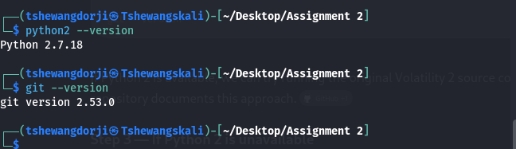

### Step 3 — Downloaded Volatility 2

I downloaded the Volatility 2 source files so I could run the memory-forensics plugins required by the assignment.

### Step 4 — Verified Volatility 2

I checked the downloaded installation and its files to confirm that Volatility 2 was present before beginning the memory-image analysis.

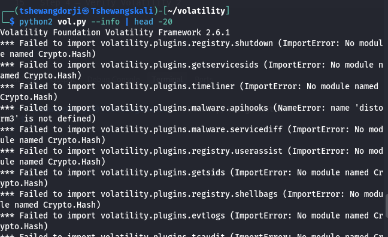

### Step 5 — Checked that the command worked

I ran a basic Volatility command to confirm that the tool started successfully and could display its available information.

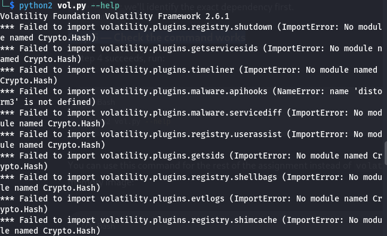

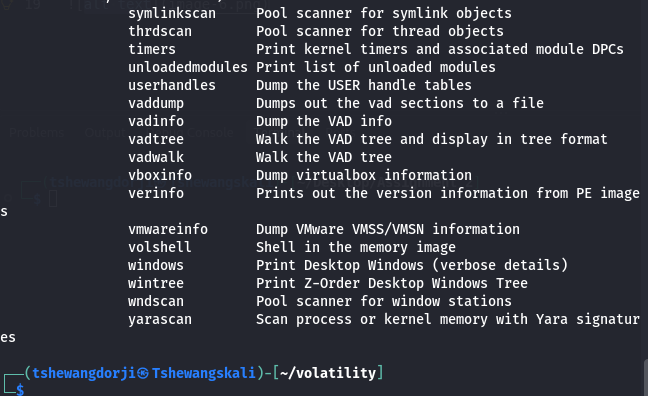

### Checked Volatility

I performed an additional check of the Volatility command and its output. This confirmed that the tool was ready for the lab investigations.

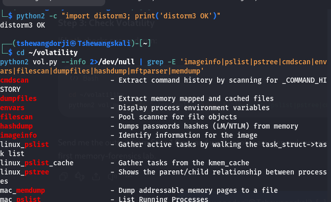

### Downloaded the Lab File

I opened the official MemLabs repository and located the challenge folders. I used each lab's instructions to obtain the corresponding memory-image archive.

I opened the official MemLabs repository.

I opened the repository to access the official challenge descriptions and download links.

I located the folders for Labs 1–5.

I opened the Lab 1 folder first and began with the first compulsory challenge.

I read the lab README and followed its memory-image download link.

I downloaded the archive and repeated the same process for Labs 2–5.

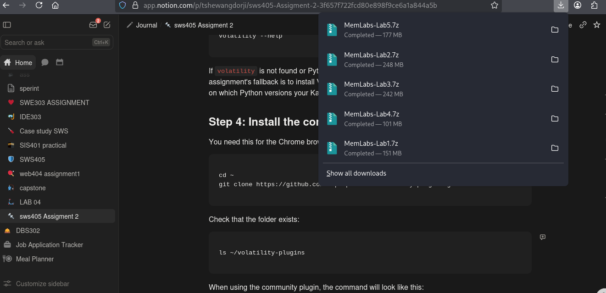

### Created folders for Labs 1–5

I created separate folders for the five compulsory labs. Keeping each memory image in its own folder helped prevent evidence and extracted files from different labs from being mixed together.

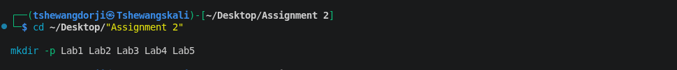

### Extracted Lab into this folder

I extracted the downloaded archive into the matching lab folder so the raw memory image was available for analysis.

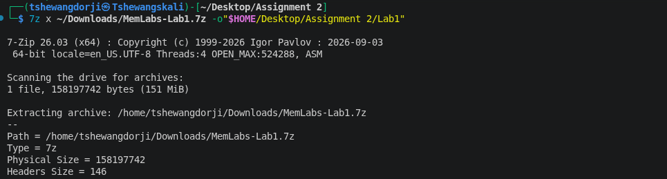

### Checked all five lab folders

I checked that the folders for Labs 1–5 had been created and that the downloaded lab files were organized before analysis began.

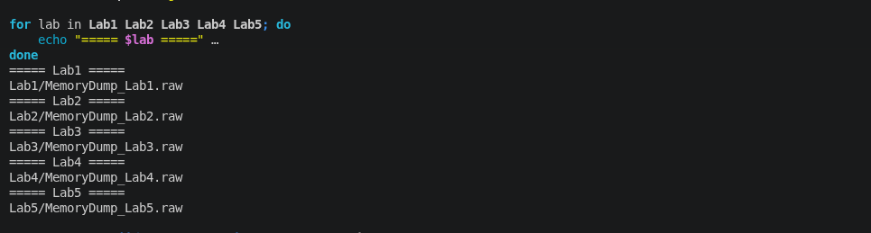

## Lab 1 — Beginner’s Luck
### Ran imageinfo

I ran `imageinfo` against the Lab 1 memory image to identify the likely Windows operating-system profile. Volatility needs the correct profile to interpret Windows structures in the memory dump.

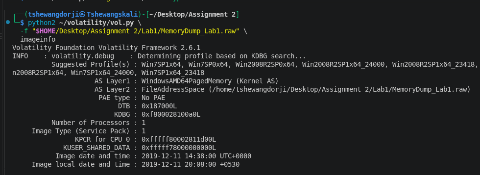

### Listed running processes (pslist)

I used `pslist` to identify processes represented in the memory image. The list helped establish which applications were active and which ones were relevant to the scenario.

### Examined the process tree (pstree)

I used `pstree` to view parent–child process relationships. This provided context about how applications were launched and helped avoid assuming that all processes belonged to the same activity.

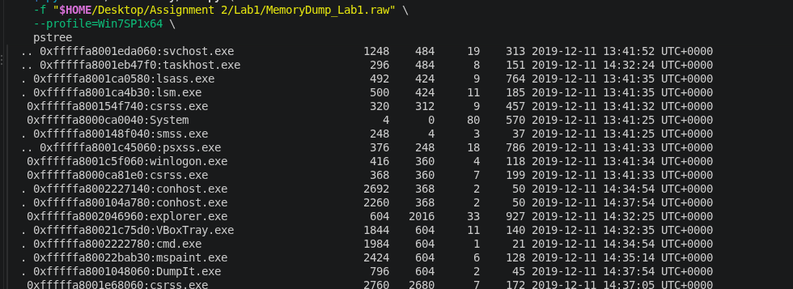

### Saved the investigation evidence

I saved the command output so that the process and profile findings could be referred to later and supported by screenshots in the report.

### Displayed the process list

I displayed the saved process-list output and reviewed it for applications related to the challenge, including archive, command-line, and image-editing tools.

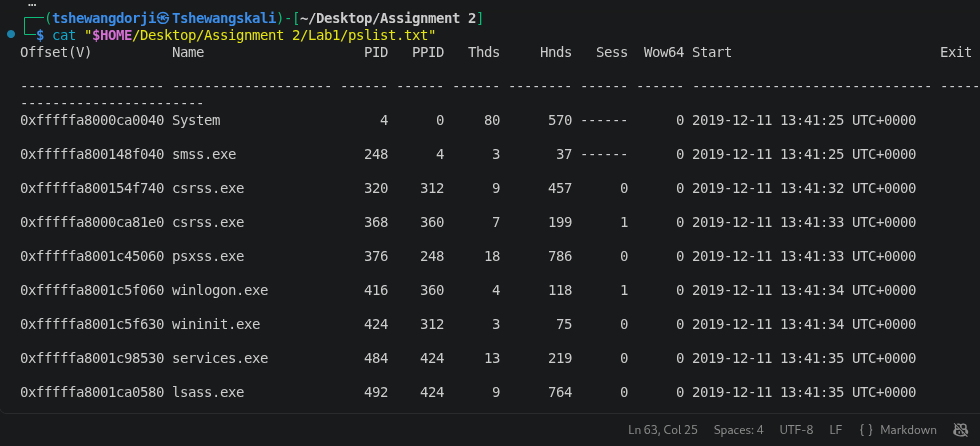

### Displayed the process tree

I reviewed the process tree to understand the relationships between the relevant processes and their parent processes.

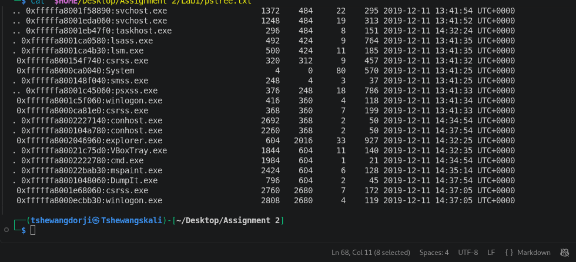

What we found

From the actual output:

| Process | PID | Interpretation |
|---|---:|---|
| `explorer.exe` | 2504 | Windows desktop shell for one user session |
| `WinRAR.exe` | 1512 | An archive utility was running |
| `cmd.exe` | 1984 | A command prompt was running |
| `mspaint.exe` | 2424 | Microsoft Paint was running |
| `DumpIt.exe` | 796 | A memory-dumping utility was running |

Important clue: WinRAR.exe is particularly worth investigating because Lab 1 involves a password-protected archive. However, this alone does not prove which archive was opened or reveal its password.

the process tree also shows that WinRAR.exe and mspaint.exe are children of explorer.exe PID 2504 and cmd.exe is under explorer.exe PID 604. These were separate desktop sessions, so I did not assume that all the processes belonged to one continuous user activity.

### Inspected command history next

After identifying relevant processes, I examined command-history and console artifacts. These artifacts can preserve commands typed by a user and may reveal filenames, scripts, or encoded strings.

investigate whether the user typed commands that reveal the archive location or password.

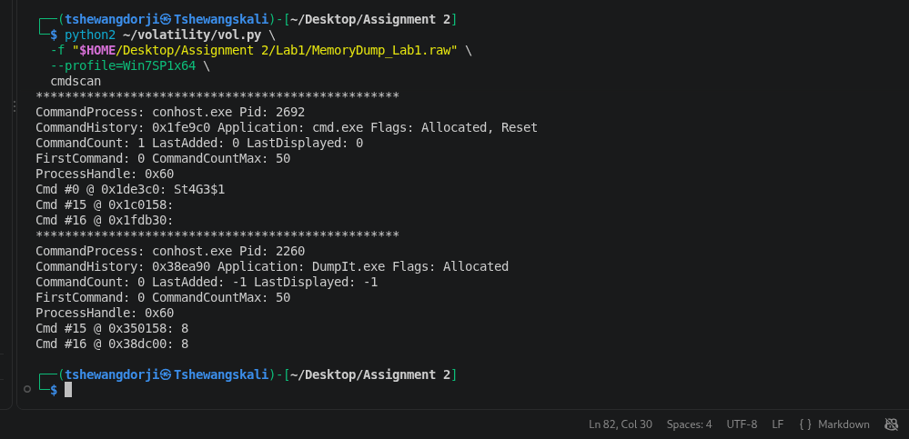

### Saved the results for the report

I saved the command-history results so that the investigation log would record the evidence examined and the output used to support later conclusions.

### Displayed the results:

I displayed the saved output and checked it for unusual strings or commands that could lead to additional evidence.

### Revealed an important clue: a Base64-encoded flag.

The output contained a string that appeared to be Base64-encoded. Base64 is an encoding format, not encryption, so decoding the string was the next step to check whether it contained readable evidence.

#### Flag 1 — Evidence screenshot
**Evidence shown:** the Base64 string was decoded and the recovered text was displayed.

### Decoded the string in Kali

I decoded the recovered Base64 string in Kali and compared the result with the expected flag format. The screenshot records the decoded result.

### Saved the evidence

I saved the decoding output as evidence so the report could connect the original encoded artifact to the recovered text.

#### Flag 2 — Evidence screenshots
**Evidence shown:** the Paint process was identified, its memory was examined, and candidate bitmap data was extracted. The final flag text should be copied from the relevant screenshot if it is visible there.

### Found the MSPaint process

I searched the process list for `mspaint.exe` because the scenario referred to drawing. This made the Paint process a relevant source of possible image data.

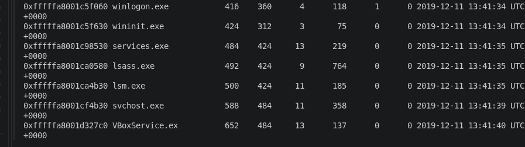

### Dumped the process memory

I dumped the memory associated with the Paint process for further examination. Process memory can contain application data that is not available as a normal file on disk.

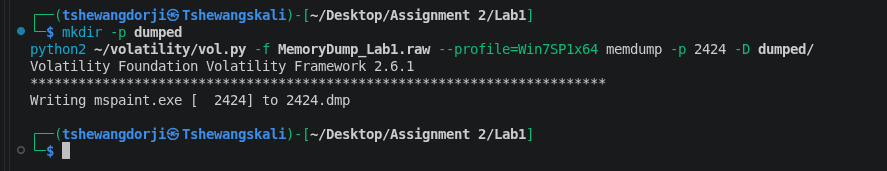

### Identified the dumped file

I checked the resulting dump file and its properties to establish which artifact would be examined for image-related content.

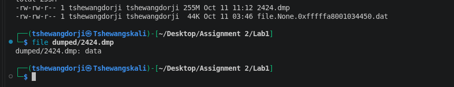

### Searched for bitmap headers

I searched the raw process dump for bitmap-file signatures. File signatures can help identify embedded image data even when the data is stored inside a larger memory dump.

### Checked the bitmap headers

I checked the candidate bitmap signatures and offsets to decide whether they could indicate image content worth extracting.

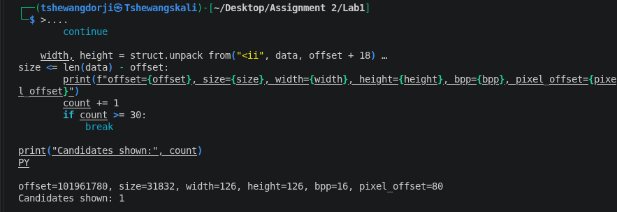

### Extracted the BMP

I extracted the candidate bitmap data for inspection as a separate image artifact. The recovered output was then checked against the screenshot evidence.

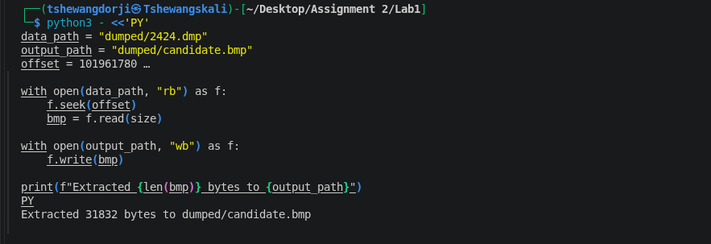

### Found other possible bitmap images

I searched for additional image signatures because a process dump may contain more than one image fragment or candidate image.

### Checked the MSPaint dump for image-related data

I examined the Paint process dump for further image-related strings or data, checking whether the earlier candidate was supported by other evidence.

### Opened the raw dump in GIMP

I opened the recovered image or raw data in GIMP to visually inspect whether it contained meaningful image content. This step supplemented the signature search with a visual check.

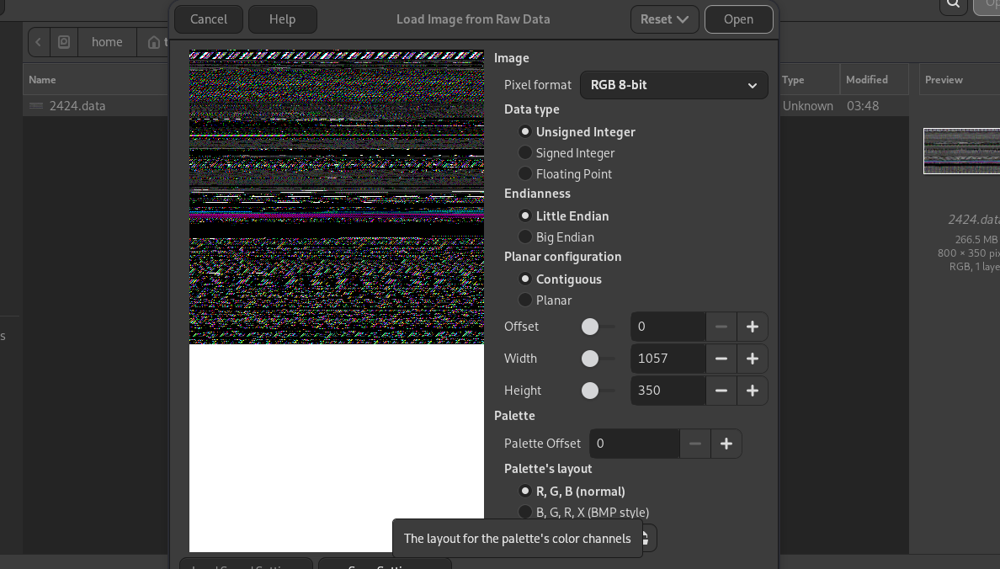

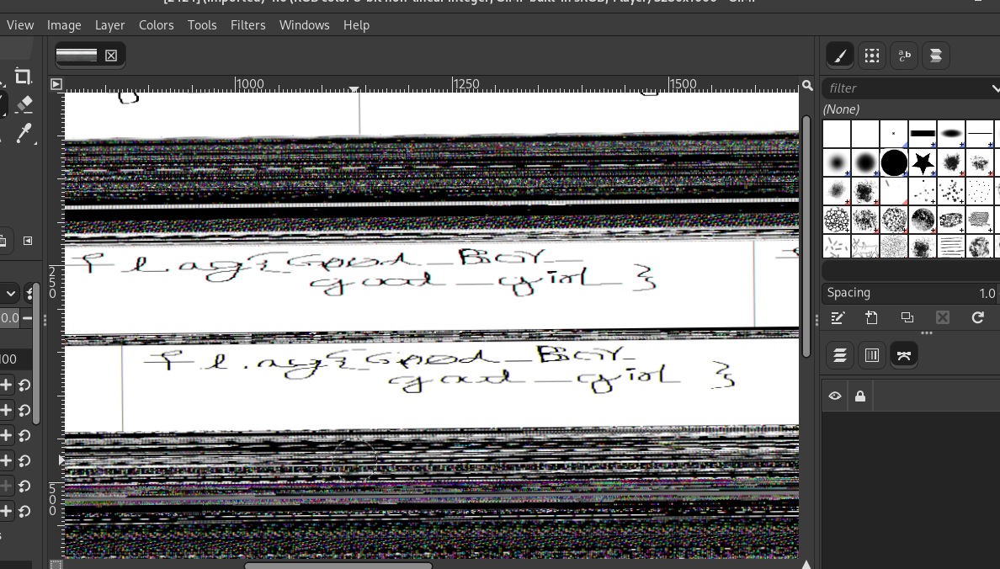

#### Flag 3 — Evidence screenshots
**Evidence shown:** the archive was located in memory, extracted, and its image was inspected. The exact flag text was not transcribed in the supplied notes.

### Ran filescan

I ran `filescan` to search memory for file objects. This is useful when a file was open or referenced during the captured session, even if it is not readily available in the original lab folder.

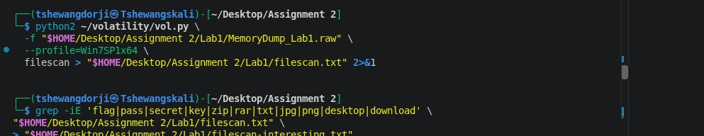

### Searched for interesting files

I filtered the file-scan output for filenames and extensions relevant to the challenge. The purpose was to narrow a large list of file objects to artifacts worth examining.

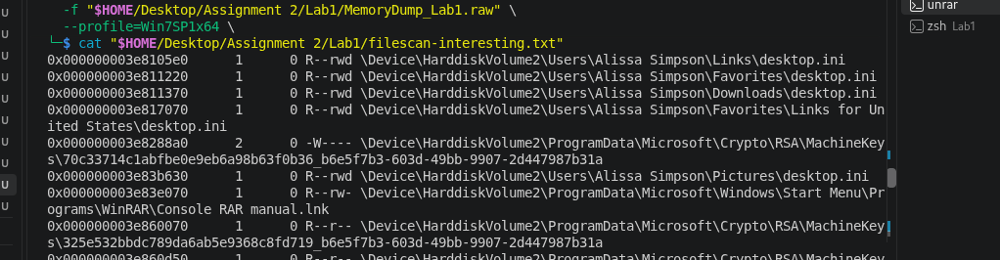

### Dumped Important.rar from memory

I used the relevant file-object offset with `dumpfiles` to attempt to recover `Important.rar` from memory. The extracted archive could then be tested independently.

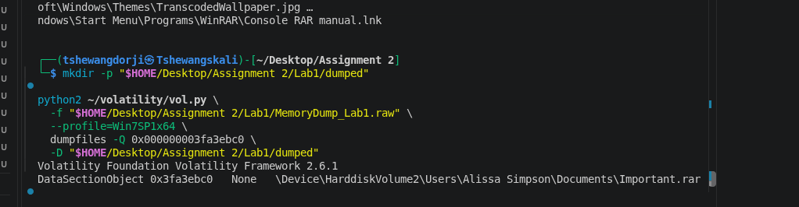

### Step 7: Checked the extracted file

I checked the recovered archive to confirm that an output file had been created and to prepare it for further examination.

### Tested the recovered RAR archive

I tested the RAR archive to check whether it was readable and whether it required a password before its contents could be extracted.

### Extracted the archive

I attempted to extract the archive using the available archive utility. The result helped establish whether the archive was protected and what additional evidence was needed.

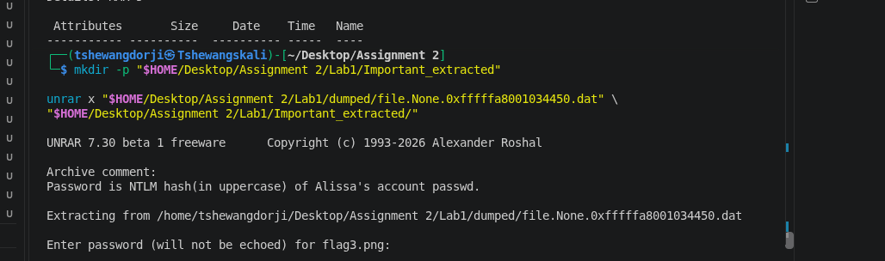

### Recovered Windows password hashes

I used `hashdump` to examine whether Windows account password hashes could be recovered from the memory image. Hashes can support password-related investigation, but they are not the same as plaintext passwords.

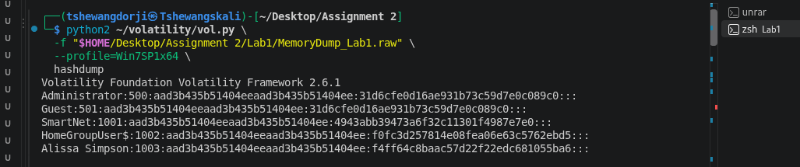

### Extracted flag3.png

After the archive credential was identified from the available evidence, I extracted the image file and inspected it for the final Lab 1 flag.

extraction succeeds, check the file:

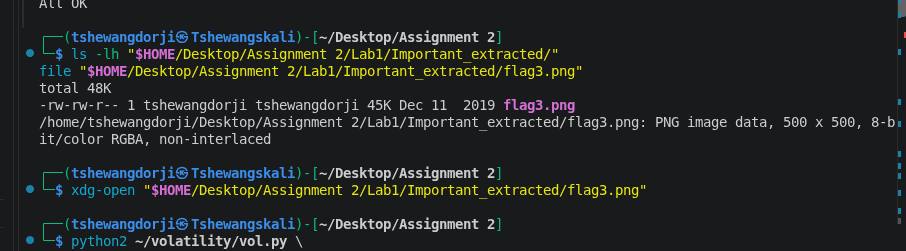

#### Flag 3 evidence
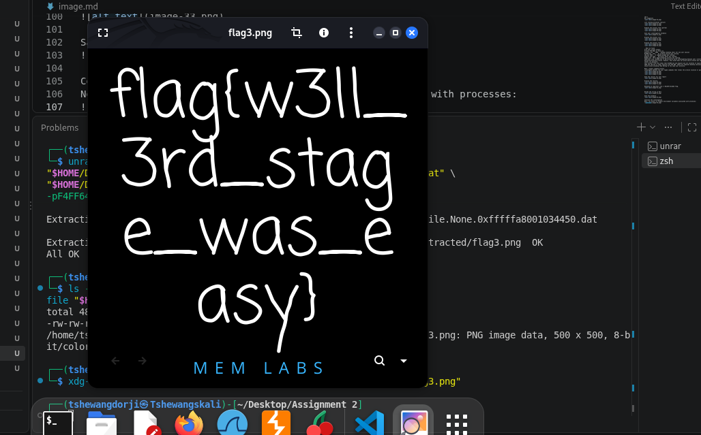

### Forensic reasoning

The process-list and process-tree results established the system context and identified applications relevant to the scenario. `cmdscan`/console artifacts were useful for investigating typed commands and the encoded string; decoding the recovered Base64 data converted the encoded artifact into readable evidence. The `mspaint.exe` process was investigated separately because the scenario referred to drawing: dumping its process memory and searching for bitmap signatures can reveal image data that may not exist as a normal standalone file. Finally, `filescan` and `dumpfiles` were appropriate for locating and extracting the archive from memory, while `hashdump` was investigated because the archive required a credential. The screenshots in this section should be used to show the actual outputs supporting each recovered flag.

### Result

The supplied notes document three evidence paths: a Base64-encoded string in command/console artifacts, image data recovered by examining the Paint process memory, and an archive recovered from memory. The exact flag text should be read from the corresponding evidence screenshots where it is not transcribed in the notes.

## Lab 2 — A New World
### Checked the Lab 2 files

I checked the Lab 2 working folder to confirm the memory image and supporting files were available before starting the second investigation.

### Identified the memory profile

I ran `imageinfo` on the Lab 2 image and selected the appropriate Windows profile from the reported suggestions for the subsequent plugin commands.

### Saved the initial investigation results

I saved the initial profile and process findings to preserve the starting point of the investigation and make the steps reproducible.

### Found the interesting evidence

I reviewed the initial outputs for processes and artifacts that matched the scenario, then used those clues to choose the next investigation steps.

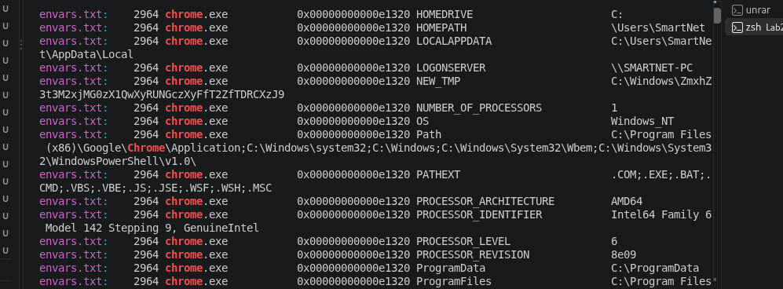

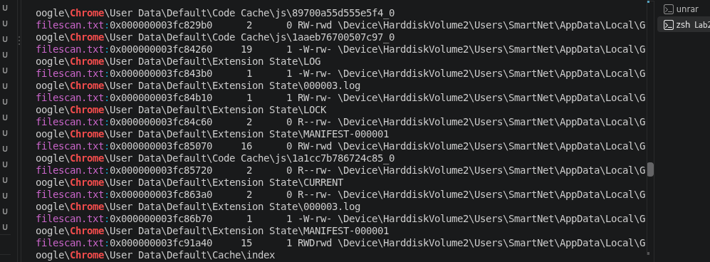

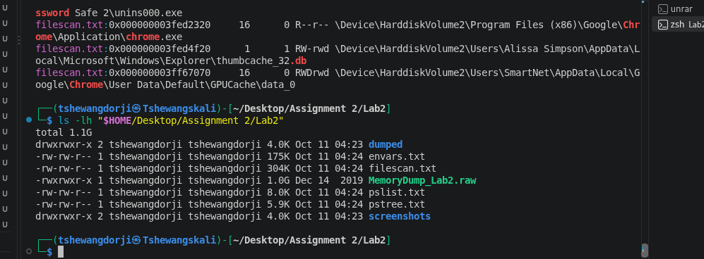

### Looked for the KeePass database and examined the environment variables

I examined environment variables and searched for KeePass database files. Environment variables may contain custom values, while password-manager databases can hold stored credentials and notes.

lists variable names that appear in the file and drops the common ones by exact name:

Variables that appear only once or twice are the custom ones. Standard ones show up dozens of times. Look for an odd name in that list, then show its full line

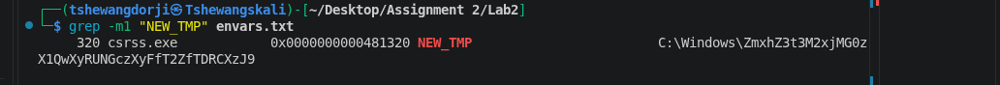

copy only the value, the part after NEW_TMP, and decode it:

#### Flag 1 — Evidence screenshot
**Evidence shown:** the unusual `NEW_TMP` environment-variable value was decoded.

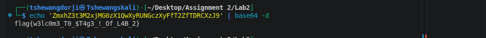

I found the password database.

This searches the file-scan results for KeePass database files and possible deleted-record clues.

### Extracted Hidden.kdbx

I used the file-scan result to identify the KeePass database and attempted to recover it with `dumpfiles` so it could be examined with KeePass.

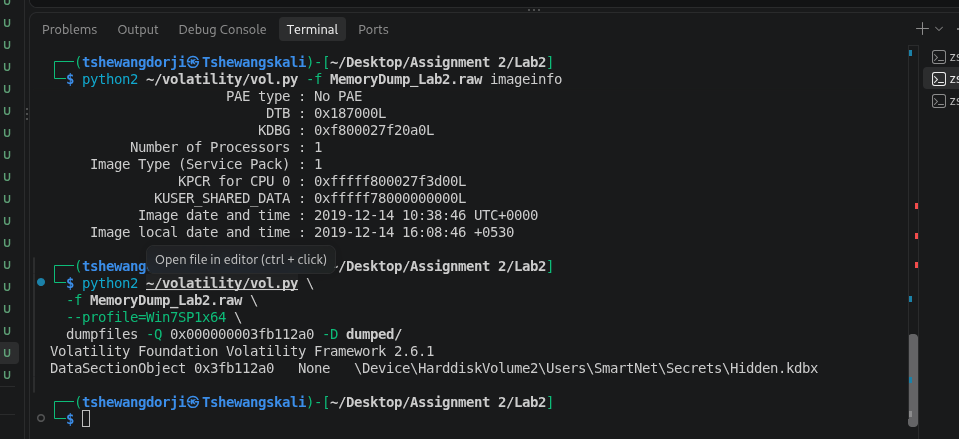

### Checked the extracted file

I checked the extracted database file to confirm that it was available for analysis and was not simply an empty or invalid output.

### Compared the two KeePass files

I compared the candidate KeePass files to determine which recovered database was relevant to the challenge.

### Checked the KeePass database files

I inspected the recovered database files and their names or properties to choose the appropriate file for the password-manager investigation.

### Compared the database files

I compared the available database artifacts to support the selection of the database used in the next step.

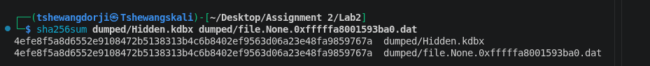

### Opened the recovered database

I opened the recovered KeePass database with the password clue found during the investigation. This allowed the database entries to be examined without guessing the contents.

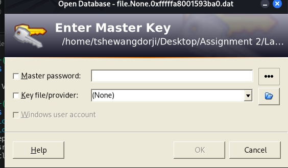

### Checked Password.png

I inspected `Password.png` because the challenge guidance indicated that a password clue was associated with a recovered image. The image served as supporting evidence for opening the database.

#### Flag 2 — Evidence screenshot
**Evidence shown:** the recovered KeePass database was opened and the flag-bearing entry was examined.

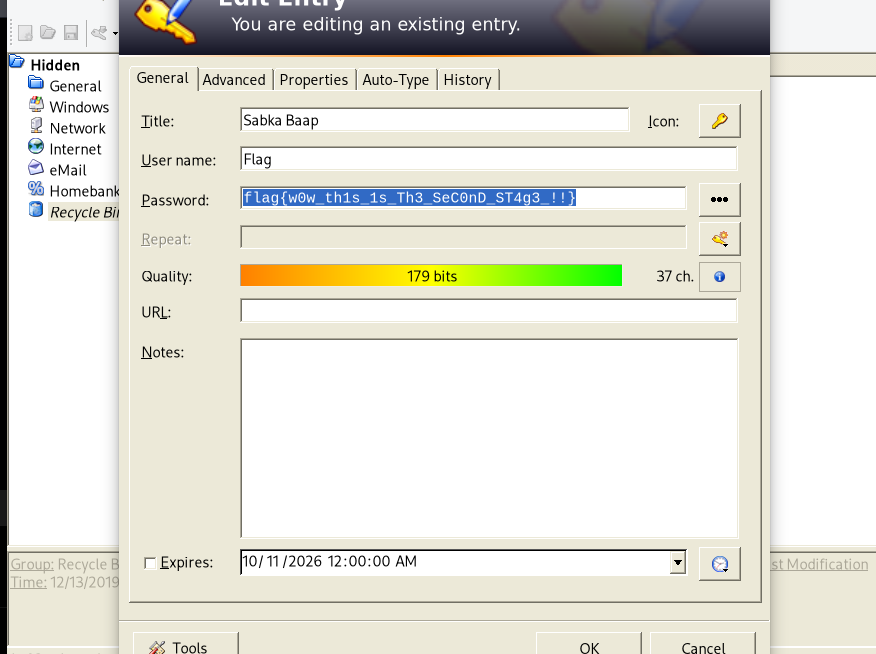

### Recovered the Second Flag

The second flag was recovered from a KeePass password database named `Hidden.kdbx`. The database was identified in the memory image using Volatility 2.6.1 and extracted with the `dumpfiles` plugin. The database was opened using KeePass 2 after locating the password clue in `Password.png`. Inside the database's **\*\*Recycle Bin\*\*** group, an entry titled `Sabka Baap` with the username `Flag` contained the second flag. The entry's creation and modification timestamps were recorded as supporting forensic evidence.

### Found the third flag

I investigated browser-related artifacts to identify the route to the protected file needed for the third flag.

check which browser processes were present in memory:

search the existing file-scan output for browser-related artifacts

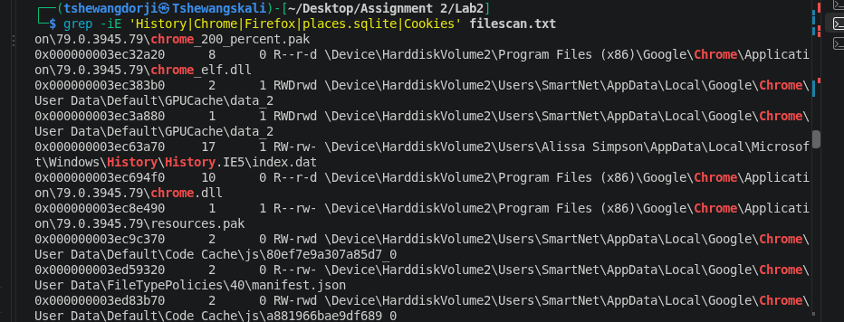

### Extracted Chrome History

I used the community `chromehistory` plugin to recover or examine Chrome history artifacts. This plugin was suitable because the browser involved in this lab was Chrome.

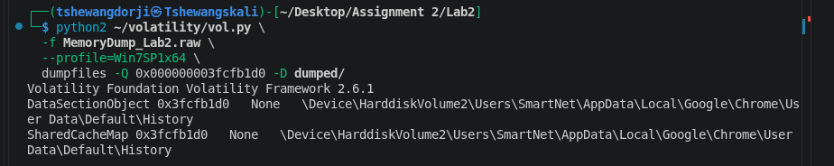

### Identified the extracted file

I checked the extracted browser-history artifact to confirm its location and identify the file to inspect next.

### Checked the extracted SQLite database

I opened the browser-history database with SQLite tools to inspect the stored browsing records.

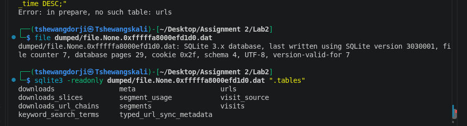

### Checked the database integrity and whether the urls table existed

I checked that the recovered SQLite database could be read and that the expected URL table was present before querying its records.

### Recorded the MEGA link and downloaded the file

I recorded the file-sharing link found in the browser history and retrieved the referenced archive for analysis. The link connected the browser artifact to the next evidence source.

### Located the ZIP file and inspected the archive without extracting it

I located the downloaded ZIP archive and inspected its listing or comment before extraction. Archive comments can contain instructions needed to derive a password.

### Extracted the inner ZIP

I extracted the relevant archive layer so the protected evidence file could be accessed and examined.

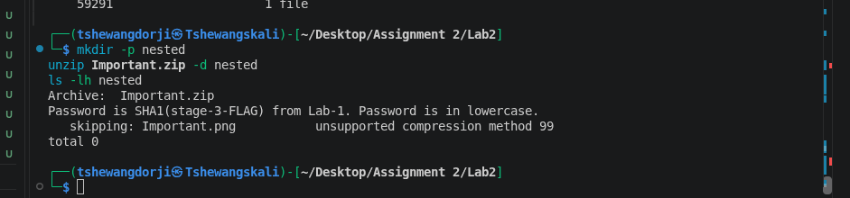

### Recalculated the hash

I calculated the required hash transformation using the flag identified earlier. The exact algorithm and letter case were taken from the archive instructions rather than guessed.

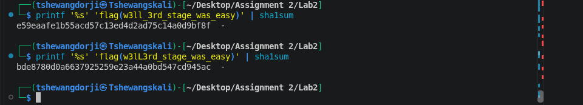

### Retried extraction

I retried extraction with the derived password and checked whether the archive accepted it.

### Verified and opened the image

I checked the extracted image file and opened it to confirm that it contained the expected evidence.

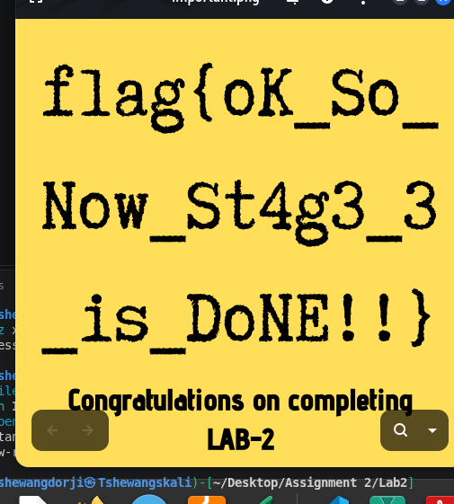

#

### Forensic reasoning

The `envars` plugin helped identify the unusual `NEW_TMP` environment-variable value, which was decoded to recover the first flag. `filescan` and `dumpfiles` were then used to locate and extract `Hidden.kdbx`. The password clue in `Password.png` allowed the database to be opened, and its Recycle Bin group contained a recovered entry with the second flag. For the third flag, the community `chromehistory` plugin was appropriate because the relevant artifacts came from Chrome history; the MEGA link led to a protected ZIP archive whose comment specified a lowercase SHA-1 transformation of the Lab 1 stage-three flag.

### Result

The investigation notes record recovery of the first flag from an environment variable, the second from a KeePass Recycle Bin entry, and the third from a file reached through Chrome history. Refer to the screenshots in this section for the exact recovered flag text and supporting outputs.

## Lab 2 — A New World: Investigation Summary**

I analysed the Windows 7 memory image using Volatility 2.6.1 and identified the `Win7SP1x64` profile. First, I examined the environment variables and discovered an unusual `NEW_TMP` value containing Base64-encoded data. Decoding this value revealed the first flag.

Next, I located and extracted the KeePass database (`Hidden.kdbx`). I used the password clue recovered from `Password.png` to open the database and examined its Recycle Bin, where I found the second flag in a recovered entry.

Finally, I investigated Chrome browser history using the community `chromehistory` plugin and identified a MEGA folder link. I downloaded `Important.zip` and inspected its archive comment, which instructed me to derive the password using the lowercase SHA-1 hash of the stage-3 flag from Lab 1. After calculating the correct hash, I successfully extracted `Important.png` and recovered the third flag.

## Lab 3 — The Evil’s Den
### Identified the memory profile

I ran `imageinfo` on the Lab 2 image and selected the appropriate Windows profile from the reported suggestions for the subsequent plugin commands.

### Identified running processes

I examined the process list to identify applications related to the Lab 3 scenario and to establish which processes could provide command-line or file clues.

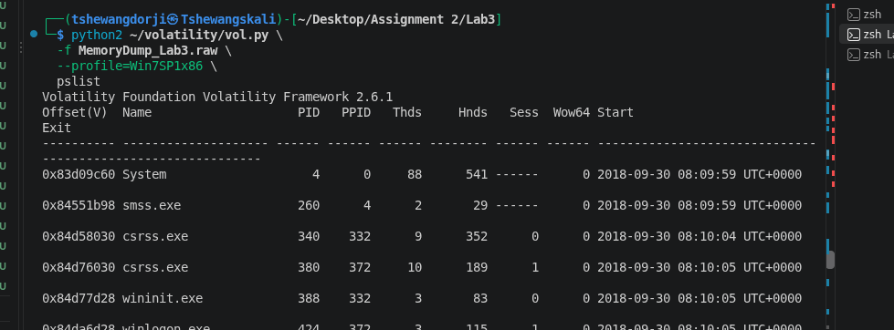

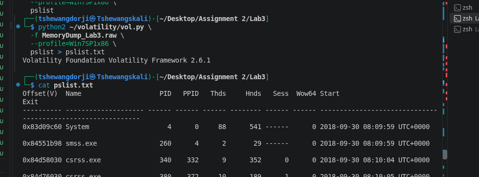

### Checked the Notepad processes

I focused on the text-editor process because the lab guidance indicated that a script and its output were associated with text-editing activity.

### Found the suspicious files

I searched the file artifacts for the script and output files indicated by the process or command-history evidence.

### Found the hidden image

I searched for image files that might contain concealed information and reviewed filenames for anything unusual in the context of the scenario.

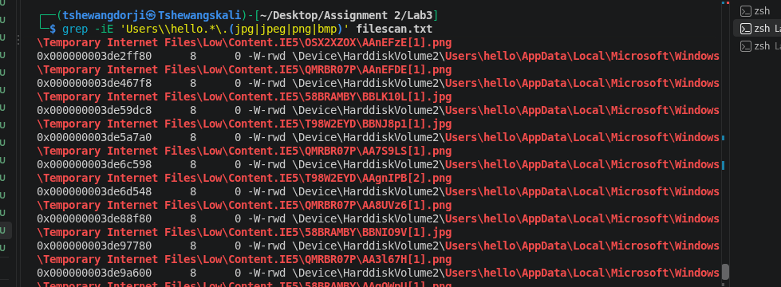

### Checked the running processes

I revisited the process information to confirm which process and associated artifacts were relevant before extracting the text file.

### Extracted vip.txt

I extracted `vip.txt` from the memory image so its contents could be read and analysed separately.

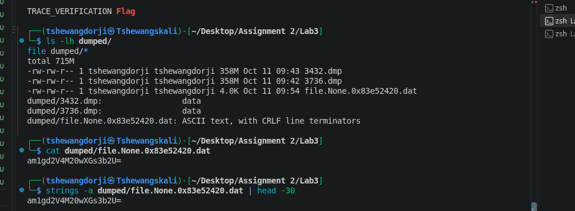

### Read the extracted text file

I read the recovered text file and examined the encoded content before attempting to reverse the transformation.

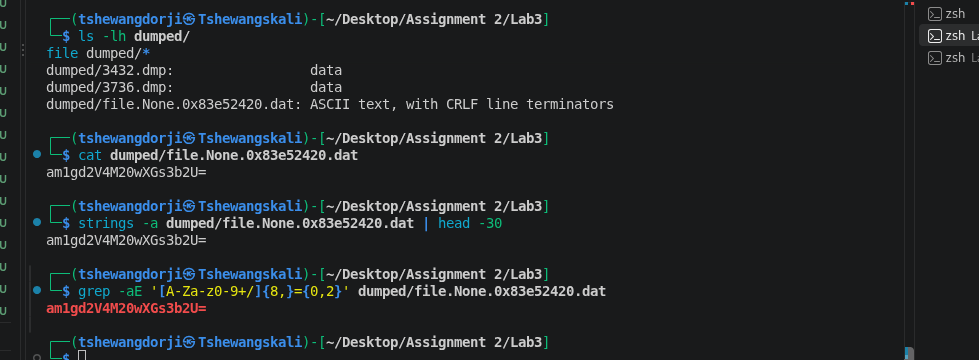

#### Flag — Part 1 evidence
**Recovered text recorded in the notes:** `inctf{0n3_h4lf`

### Decoded the text by applying XOR with 3

I reversed the transformation described by the script by applying XOR with the value 3. This recovered the first half of the flag from the transformed output.

first part of the flag

inctf{0n3_h4lf

#### Flag — Part 2 evidence
**Evidence shown:** the hidden message was extracted from the image. The second half and combined flag must match the steghide output screenshot.

### Extracted the hidden text and read the message

I used the image's steganographic content as the next evidence source and read the extracted message to recover the other part of the flag.

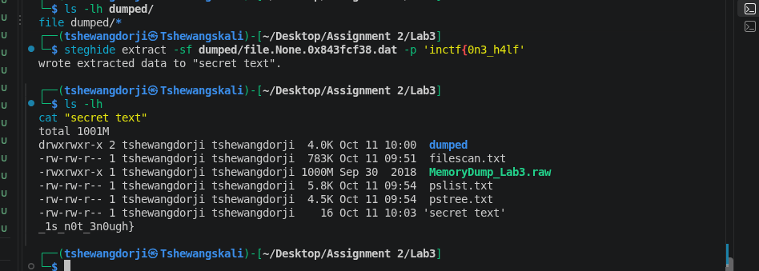

### Combine the flag parts

The published Lab 3 solution indicates the second part is \_1s_n0t_3n0ugh}. If the extracted message confirms that, 

the complete flag is: inctf{0n3_h4lf_1s_n0t_3n0ugh}

### Forensic reasoning

The investigation used process and command-line evidence to identify the relevant text-editing activity and suspicious files. Extracting and reading `vip.txt` exposed data transformed using an XOR operation with the value 3. Reversing that transformation recovered the first part of the flag. The image and steganography investigation then recovered the hidden second part. This demonstrates how a memory investigation can combine command history, file recovery, basic code analysis, reversible transformations, and steganography to correlate two pieces of evidence.

### Result

The notes transcribe the first half as `inctf{0n3_h4lf` and record the complete flag as `inctf{0n3_h4lf_1s_n0t_3n0ugh}`. Confirm that the steghide extraction screenshot supports the second half before final submission.

## Lab 4 — Obsession
### Checked the Lab 4 folder and identified the correct profile

I checked the Lab 4 files and used `imageinfo` to identify the likely Windows profile for the memory image.

### Inspected running processes

I examined the running-process information to understand the system context before searching for the deleted file.

### Searched for the deleted file

I searched the file-scan output for the important text file. A filename appearing in a scan does not guarantee that the complete file data can still be extracted.

### Ran pstree with the correct profile

I used `pstree` with the selected profile to review process relationships and record the system context for the investigation.

### Searched for the important file

I filtered the file-scan results for the important filename so I could record its memory offset and attempt normal extraction.

### Tried dumping Important.txt

I attempted to recover `Important.txt` using `dumpfiles`. The unsuccessful or incomplete result was important evidence because it showed that finding a file object did not necessarily restore its content.

### Parsed the MFT

I used `mftparser` to examine NTFS Master File Table records represented in memory. MFT records may retain filename or content fragments associated with a deleted file.

### Found Important.txt in the report

I searched the MFT output for `Important.txt` and examined the matching record or content fragments for recoverable data.

#### Flag — Final evidence screenshot
**Evidence shown:** hexadecimal data recovered from the MFT output was decoded into readable text. The exact flag was not transcribed in the supplied notes.

### Decoded the hexadecimal data using CyberChef

I decoded the recovered hexadecimal data with CyberChef to convert the evidence into readable text. The result was checked against the final screenshot before recording the flag.

finally we can retrieve the flag

### Forensic reasoning

The suspicious desktop image was investigated first as a possible steganography lead, but it did not provide the required flag. This dead end was recorded rather than treated as proof that no evidence existed. The `filescan` result showed the important text file, but `dumpfiles` did not recover useful content. That difference matters: finding a file object or filename in memory does not guarantee that the plugin can reconstruct the file's data. `mftparser` was then used to inspect NTFS Master File Table records still represented in memory; the recovered record/content fragments could be decoded to obtain the flag.

### Result

The screenshots document the MFT-based recovery and decoding process. Use the flag shown in the final evidence screenshot; its exact text is not transcribed in the supplied notes.

## Lab 5 — Black Tuesday
### Checked the Lab 5 files and identified the correct memory profile

I checked the Lab 5 folder and used `imageinfo` to identify the likely Windows profile for the memory dump.

### Checked running processes

I ran `pslist` to examine the processes present in the Lab 5 image and identify applications relevant to archive use.

### Found the file paths used by processes

I examined process and file-path evidence to locate the archive associated with the archive manager.

### Checked Internet Explorer history

I used the built-in `iehistory` plugin because the browser artifacts in Lab 5 were associated with Internet Explorer. This differs from Lab 2, where the community `chromehistory` plugin was used for Chrome.

### Located the RAR archive in memory

I searched the file-scan results for the RAR archive and recorded the relevant file object so it could be extracted.

### Extracted the RAR archive

I extracted the RAR archive from the memory image with `dumpfiles`. The recovered archive was then available for password-protected extraction.

#### Flag 1 — Evidence screenshot
**Recovered flag recorded in the notes:** `flag{!!_w3LL_d0n3_St4g3-1_0f_L4B_5_D0n3_!!}`

### Decoded the Stage 1 password/flag

I decoded the unusual encoded filename found in Internet Explorer history. The readable result supplied the first-stage flag and the password needed for the archive.

### Extracted the Stage 2 flag

I used the recovered first-stage flag as the archive password and extracted the second-stage image from the RAR archive.

### Forensic reasoning

The `imageinfo` and `pslist` outputs established the Windows profile and identified `WinRAR.exe` as a relevant process. `filescan` located the archive `SW1wb3J0YW50.rar` in the user's Documents directory, and `dumpfiles` extracted it from memory. The built-in `iehistory` plugin was selected to investigate Internet Explorer history, which differed from the Chrome history examined in Lab 2. An unusually long encoded filename in the history was decoded to recover the first flag, which was then used as the archive password. Successful extraction of `Stage2.png` provided the second flag.

## 4. Overall Conclusion

The five investigations demonstrate that useful evidence can remain in a Windows memory image even when it is encoded, stored inside another application, associated with a deleted file, or accessible through process and browser artifacts. Volatility 2 provided the main workflow for profiling the images, enumerating processes, locating file objects, extracting artifacts, and examining command history. Supporting tools were used to decode data, inspect recovered files, open the password database, and examine steganographic content.

The results should be assessed together with their supporting screenshots and investigation logs. A flag alone is not sufficient evidence: the report should show which artifact revealed it, which tool was used, and why that result supports the conclusion.

